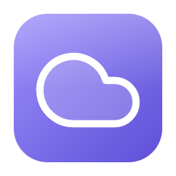
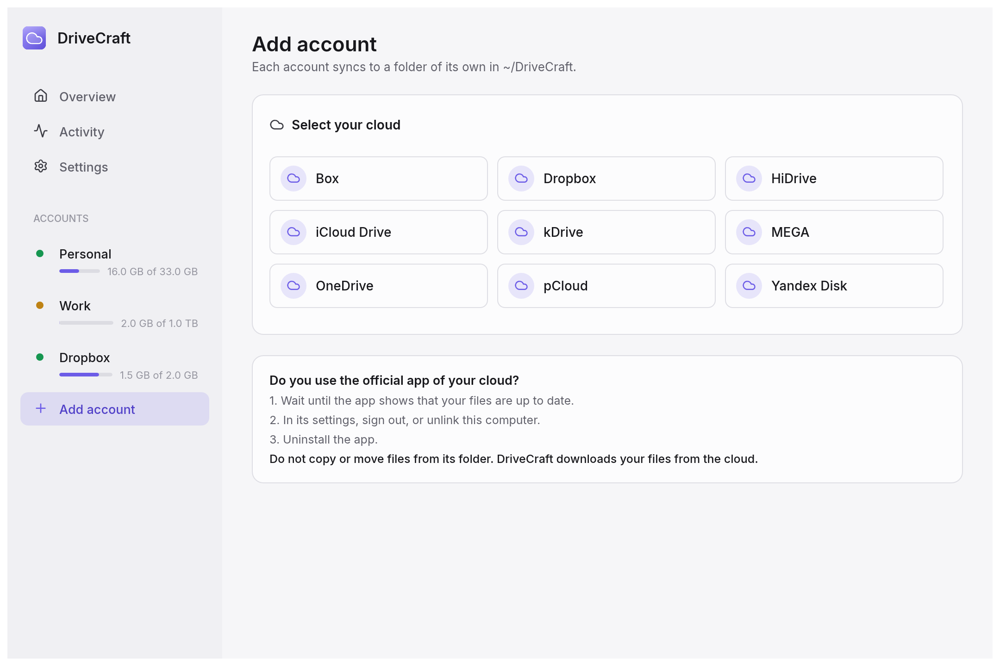

<div align="center">

<h1>DriveCraft</h1>
<p><strong>A light, private, open source replacement for the apps of OneDrive, Dropbox, Box, and more. Built on rclone.</strong></p>
<p>
<a href="https://github.com/fballiano/drivecraft/releases/latest"></a>
<a href="https://github.com/fballiano/drivecraft/releases"></a>

<a href="LICENSE-MIT"></a>
</p>
<p><a href="https://github.com/fballiano/drivecraft/releases/latest"></a></p>
</div>

<table align=center><tr><td align=center>
<strong>If you find my work valuable, please consider sponsoring</strong><br />
<a href="https://github.com/sponsors/fballiano" target=_blank title="Sponsor me on GitHub"></a>
<a href="https://www.buymeacoffee.com/fballiano" target=_blank title="Buy me a coffee"></a>
<a href="https://www.paypal.com/paypalme/fabrizioballiano" target=_blank title="Donate via PayPal"></a>
</td></tr></table>

---

Replace the official apps of OneDrive, Dropbox, Box, and more with one light,
private, open source app. Large companies make the official apps, and you
cannot see their code. DriveCraft is open source, sends no telemetry, and
puts no server of its own between your computer and your cloud.

DriveCraft keeps real copies of your cloud files in a folder on your computer,
and syncs them in both directions. You select the folders that sync; the
other folders stay only online. It works with OneDrive, Dropbox, Box, pCloud,
kDrive, HiDrive, Yandex Disk, iCloud Drive, and MEGA, and with more than one
account at a time.

DriveCraft runs on macOS, Windows, and Linux. For the sync, it uses
[rclone](https://rclone.org), a tool that people trust with their files for
more than ten years. DriveCraft includes rclone, so you install nothing else.

<p align="center"></p>

## Highlights

- **Open source.** Anyone can read the code and examine what the app does.
  Use it at no cost, under the MIT or Apache 2.0 license.
- **Private.** No telemetry, no advertising, and no account with us. Your
  files go directly between your computer and your cloud.
- **Light.** A small, native app, written in Rust. It does not include a web
  browser, so it starts quickly and uses little memory.
- **Many clouds, many accounts.** Each account syncs to a folder of its own
  in `~/DriveCraft`, so the accounts never mix.
- **Selective sync.** A switch for each folder: on, it syncs to this
  computer; off, it stays only online.
- **You choose first.** After a sign-in, nothing downloads until you select
  the folders and start the first sync.
- **Live activity.** See each file while it transfers, and each file that a
  sync changed.
- **Safe by design.** A missing folder stops the sync, so it cannot delete
  your files online. A file that changed on both sides keeps both versions.
  DriveCraft refuses the folders of other cloud apps.
- **In the tray.** DriveCraft runs in the menu bar or the system tray, like
  the official apps.

## Built on rclone

DriveCraft does not write a new sync engine. It puts a simple app on top of rclone, a tool that people trust with their files.

- **Tested for more than ten years.** [rclone](https://rclone.org) is an open source tool for more than 70 cloud storage services. Many people and companies use it every day to move, sync, and back up their files. DriveCraft uses its two-way sync and its sign-in for each cloud.
- **rclone is included.** Each package contains a tested version of rclone. DriveCraft uses its own rclone configuration, so it never changes your own rclone accounts.
- **One Rust code base.** The same code makes the app for macOS, Windows, and Linux, on x64 and Arm processors. The window uses [egui](https://github.com/emilk/egui), a fast user interface library for Rust.

## Install

### macOS

DriveCraft needs macOS 11 or later.

```bash
brew tap fballiano/tap
brew trust --tap fballiano/tap
brew install --cask drivecraft
```

To update:

```bash
brew update
brew upgrade --cask drivecraft
```

Or download the zip for your Mac (Apple silicon or Intel) from the
[latest release](https://github.com/fballiano/drivecraft/releases/latest), and
drag **DriveCraft** into **Applications**.

DriveCraft is signed with an Apple Developer ID and notarized by Apple, so it
opens like any other application.

### Windows

With [Scoop](https://scoop.sh):

```powershell
scoop bucket add fballiano https://github.com/fballiano/scoop-bucket
scoop install fballiano/drivecraft
```

To update, run `scoop update drivecraft`.

Or download the installer for your computer from the
[latest release](https://github.com/fballiano/drivecraft/releases/latest):
`DriveCraft-<version>-windows-x64-setup.exe`, or `arm64` for Arm. It installs
DriveCraft for your user, without administrator rights, and adds it to the
Start menu. The zip file has the same app without an installer: extract it,
and start `DriveCraft.exe`. Keep `rclone.exe` in the same folder.

The app has no signature yet, so on the first start Windows can show
"Windows protected your PC". Click **More info**, then **Run anyway**. Scoop
installs give no warning.

### Linux

Download the `tar.gz` file for your computer (x64 or Arm) from the
[latest release](https://github.com/fballiano/drivecraft/releases/latest).
Extract it, and start `drivecraft`. Keep `rclone` in the same folder.

## Getting started

1. If you use the official app of your cloud, read
   [Change from the official app](#change-from-the-official-app) first.
2. Start DriveCraft, and select your cloud. Sign in in the browser window
   that opens.
3. Switch off the folders that you want only online, then select
   **Start sync**.
4. To add one more account, select **Add account** in the sidebar.

## The app

- DriveCraft runs in the tray (the menu bar on macOS), like OneDrive.
- On macOS, DriveCraft has a Dock icon only while its window is open. Then the window is in Command-Tab and has a menu bar. When you close the window, the Dock icon goes away.
- Click the tray icon to open the window. Click it again to hide the window. Right-click it for a menu: status, **Sync now**, **Open DriveCraft folder**, and **Quit DriveCraft**.
- When you close the window, DriveCraft continues to run in the tray. Use **Quit DriveCraft** to stop it.
- DriveCraft starts when you sign in to the computer, after you add the first account. Then it starts in the tray, without its window. On Linux with Wayland, the window starts minimized. To stop this, turn off **Settings > Sync > Start at login**.
- When you installed DriveCraft from a download (a zip, an installer, or a `tar.gz`), it asks GitHub once a day for a new version. Then **Overview** shows **Download**, which opens the release page. DriveCraft sends no data about you, and it has no server, so only GitHub sees the request. Homebrew, Scoop, Flatpak, and the AUR update DriveCraft themselves, so these installs do not check. To stop the check, turn off **Settings > Sync > Check for updates**.
  - macOS: a login item in `~/Library/LaunchAgents`. System Settings shows it in **General > Login Items**.
  - Windows: the `Run` key of your user in the registry.
  - Linux: a file in `~/.config/autostart`. In a Flatpak, the desktop asks for your permission.
- Only one DriveCraft runs at a time. When you start it again, the running DriveCraft shows its window.
- The sidebar has three pages for all accounts: **Overview**, **Activity**, and **Settings**. Under them, **Accounts** shows each account with its status and its storage use, and **Add account**.
- The page of an account has two tabs. **Folders** selects the folders that sync. **Account** shows the storage use, the local folder, **Full resync**, and **Sign out**.
- The design follows the "Studio" look of the Craft apps: the Inter font, Lucide icons, and the Studio colors. It follows the light or dark mode of the system. You can also select a mode in **Settings**.

On Linux, the tray icon shows on KDE Plasma, Cinnamon, XFCE, MATE, Budgie, LXQt, and Ubuntu. Plain GNOME shows it only with the "AppIndicator and KStatusNotifierItem Support" extension.
On Wayland, an app cannot hide its window. There, closing the window minimizes it, and DriveCraft continues to sync. A click on the tray icon asks the desktop to show the window: the desktop shows it, or marks it in the taskbar. On X11, the tray works as on macOS and Windows.

To render each page with demo data to `target/screenshots/`, run:

```
cargo test -p drivecraft screenshots -- --ignored
```

To test the tray icon on Linux in a Wayland session and in an X11 session, run `scripts/tray-test.sh`. It needs Docker, and writes screenshots and logs to `target/tray-test/`.

To make `docs/demo.webp` again, run `scripts/demo-animation.sh` (it needs ImageMagick). To make the store screenshots in `docs/screenshots` again, run `scripts/store-screenshots.sh` (it needs ImageMagick). To make `docs/social-preview.png` again, run `scripts/social-preview.sh` (it needs ImageMagick).

## Change from the official app

Do these steps in this order:

1. Wait until the official app shows that your files are up to date. Changes that are not uploaded are lost when you unlink the app.
2. In the settings of the official app, sign out or unlink this computer:
   - OneDrive: open **Account** and select **Unlink this Mac** (or **Unlink this PC**).
   - Dropbox: open **Account** and select **Unlink**.
   - Box Drive: select **Sign out**.

   After the unlink, a change in its folder does not change the cloud.
   If you uninstall the app without this step, macOS can keep an empty, protected folder in `~/Library/CloudStorage`.
3. Uninstall the official app.
4. Start DriveCraft and sign in. Select the folders that sync to this computer.

Do not copy or move files from the folder of the official app into the DriveCraft folder. DriveCraft downloads your files from the cloud.
A move before the unlink deletes the files in the cloud, and then DriveCraft deletes them on this computer too.
When DriveCraft has downloaded your files, you can delete the old folder.

## How it works

DriveCraft keeps one local folder for each account, with real copies of your files.
It works like the official OneDrive client before "Files On-Demand", or like selective sync in Dropbox.

- `~/DriveCraft` holds one folder for each account. The folder has the name of the provider: the first OneDrive account gets `~/DriveCraft/OneDrive`, the next one `~/DriveCraft/OneDrive 2`, a Dropbox account `~/DriveCraft/Dropbox`. You can rename an account; its folder does not change.
  No other client uses this name, so the folders of DriveCraft and of other clients never collide.
  You cannot select `~/DriveCraft` itself as the folder of an account. The folders of two accounts must not be the same, and one must not be inside the other.
- In **Folders**, each switch selects a folder that syncs to this computer.
  A folder that is off is not on this computer. It stays only online.
- The files in the root of the account always sync.
- A new account starts with all top-level folders on. DriveCraft does not sync it yet: it opens **Folders** of the account.
  Switch off the folders that you want only online, then click **Start sync**. Only then does the first download start.
- When you switch a folder off, the next sync uploads all local changes first. Then it deletes the local copy. The files stay online.
- When you make a new top-level folder in the local folder, it does not sync immediately. **Overview** shows the new folder.
  Select **Sync** to upload it. Select **Do not sync** to keep it only on this computer.
  The **Account** tab shows the folders that are only on this computer. You can sync them there later.
  Hidden folders (names that start with ".") are not shown.
- DriveCraft syncs each account at an interval (10 minutes by default), and when you click **Sync now**. Only one sync runs at a time; the accounts take turns.
- **Sign out** removes the account from DriveCraft. A dialog asks what happens to its folder:
  - **Keep the folder on this computer**: the folder and its files stay. They do not sync any more.
  - **Move the folder to the Trash**: DriveCraft syncs one last time, then moves the folder to the Trash (the Recycle Bin on Windows). If the last sync fails, the account and the folder stay.
    The dialog names the folders that are only on this computer, because they go to the Trash too.
    An account that never synced moves its folder to the Trash only when the folder is empty.
- **Activity** shows each file that a sync changed: downloaded, uploaded, deleted on this computer, or deleted online.
  DriveCraft compares lists of the synced local files before and after each sync. It keeps the last list of each account in `snapshot-<id>.json` in the settings folder.
- OneDrive and Google Drive block the download of files that they mark as infected with a virus. DriveCraft reports each such file one time in **Activity**, then skips it in later syncs.
  To download these files anyway, turn on **Settings > Sync > Download blocked files**. Scan such files before you open them.
- Some providers do not report the storage use. Then the **Account** tab says so.
- A provider can end a sign-in, for example after you change your password. Then DriveCraft stops the sync of that account and shows **Sign in again** in **Overview** and on the account page. Your files stay on this computer. After the new sign-in, the sync continues.
  To sign in again at a different time, use **Sign in again** on the **Account** tab.
- When a file changed on this computer and online since the last sync, DriveCraft keeps both versions. The newer version keeps the name. The other version gets a copy with "conflict" in the name, for example `report.conflict1.docx`, on both sides. **Activity** shows it as a conflict copy.
- DriveCraft never syncs system files: `.DS_Store`, `._*`, `Thumbs.db`, `desktop.ini`, and Office lock files (`~$*`, `.~lock.*`).

DriveCraft refuses a folder that a different cloud app syncs, because two apps that sync the same folder can delete files:

- macOS: all folders in `~/Library/CloudStorage`, and links into that location (for example `~/OneDrive`). macOS gives this location to the apps of OneDrive, Google Drive, Dropbox, and Box.
- Windows: the folder of each account in the official OneDrive app.
- Linux: the `sync_dir` folder of the `onedrive` client.
- All systems: the folders of the Dropbox app (from its `info.json`).
- macOS and Windows: `~/Box` (Box Drive) and `~/Google Drive` (the old Google app).
- All systems: `~/pCloud Drive`, `~/kDrive`, and `~/Yandex.Disk`, the default folders of these apps.
- iCloud Drive: `~/Library/Mobile Documents` on macOS, and `~/iCloudDrive` of the iCloud app for Windows.
- All systems: `~/MEGA` and `~/MEGAsync`, the folders of the MEGA app.

Google Drive for desktop on Windows uses a separate drive letter (for example `G:`). DriveCraft refuses the root of that drive, but not yet a folder inside it.

DriveCraft does the check when you select a folder, and again before each sync.

When a sync finds a file with different content on the two sides, and there is no earlier sync to compare with, DriveCraft keeps the newer version. This occurs at the first sync, after a change of folders, and after **Full resync**.

## Questions and answers

### Is DriveCraft an app for rclone?

Yes. DriveCraft is an easy app for the two-way sync of rclone, the same on macOS, Windows, and Linux. You do not use the command line, and you do not install rclone: DriveCraft includes it.
DriveCraft does not write a new sync engine. rclone does the sign-in and the sync; DriveCraft adds the window, the tray icon, the folder selection, and the safety checks.

### Why not use rclone bisync directly?

You can. DriveCraft uses the same rclone. It adds these parts:

- A sign-in for each provider, and a switch for each folder.
- Checks before each sync. For example, a missing local folder stops the sync, and a change of folders starts a full resync.
- Safe settings for bisync. A full resync keeps the newer version, and a file that changed on both sides keeps both versions.
- A tray icon, a sync at an interval, and a list of each file that a sync changed.
- More accounts, each in a folder of its own. DriveCraft uses its own rclone configuration, so it does not change your rclone accounts.

### Is a two-way sync safe for my files?

A two-way sync also syncs deletes. When you delete a file on this computer, the next sync deletes it online too. DriveCraft has checks against the errors that cause large deletes (see [How it works](#how-it-works)):

- A missing local folder stops the sync.
- A full resync never deletes files.
- Before DriveCraft removes the local copy of a folder that you switched off, it uploads the changes in that folder.
- DriveCraft refuses the folders of other cloud apps.

DriveCraft is a new project. Keep a backup of the files that you cannot lose. Most providers also keep deleted files in an online recycle bin for some days.

### What happens when a file changes on this computer and online?

DriveCraft keeps both versions. The newer version keeps the name. The other version gets a copy with "conflict" in the name, for example `report.conflict1.docx`. MEGA works differently: see [Providers](#providers).

### Does DriveCraft have placeholder files, like Files On-Demand?

No. Each folder that syncs has real copies of the files. A folder that you switch off stays only online. Placeholder files are in phase 3 of the [plan](#plan).

### How fast does a change sync?

DriveCraft syncs each account every 10 minutes by default. To sync immediately, click **Sync now**. A sync when a local file changes is in phase 2 of the [plan](#plan).

### Can DriveCraft see my files or my password?

DriveCraft has no server. Your files go directly between your computer and your cloud.
For most providers, you sign in in your browser, so DriveCraft never sees your password. For iCloud Drive and MEGA, DriveCraft gives the password to rclone for the sign-in only, and then removes it.
DriveCraft sends no telemetry. The only request that it makes for itself is the daily check for updates, and you can turn it off.

### Why is there no Google Drive?

See [Google Drive](#google-drive).

### What does DriveCraft cost?

Nothing. DriveCraft is open source, under the MIT or Apache 2.0 license. To support the work, use the sponsor links at the top of this page.

## GenAI transparency

DriveCraft follows the same rules as [Maho](https://mahocommerce.com), the open source ecommerce platform of the same author
(read the [Maho GenAI transparency statement](https://mahocommerce.com/about/genai-transparency/)).

Generative AI is part of the daily work on DriveCraft. We do not hide it. It lets one person make and maintain an app for three operating systems and nine clouds.
Our primary tool is Claude Code, with the Claude models of Anthropic. AI helps to write and refactor the code, to write tests, and to write the documentation.

A large amount of human work stays: to define the features and the safety rules, to design the app, to review the code, to test with real accounts, and to answer issues.
Automated checks control each change: `cargo fmt`, `cargo clippy` with all warnings as errors, and the tests on macOS, Windows, and Linux.
The rules that protect your files are in [`AGENTS.md`](AGENTS.md), and each change must keep them. The maintainer reviews each change. We never release changes that only an AI made.

AI use in your pull requests is welcome. You do not have to declare it, but you must understand the code that you send and stand behind it.

## Structure

```
crates/core   The core. It controls rclone and contains all sync logic. It has no UI code.
crates/app    The egui UI. It only sends commands to the core and shows events.
scripts/      Packaging scripts.
```

The core starts `rclone rcd` and uses the rclone remote control API:

- The API listens on 127.0.0.1 only.
- The API needs a random password. The password goes through environment variables.
- The sync uses `sync/bisync` with a generated filter file.

## Bundled rclone

DriveCraft includes rclone. You do not install rclone yourself.
DriveCraft never uses an rclone from the `PATH`. It always uses the bundled version, because that is the version that we test.

At build time, `crates/app/build.rs` does these steps:

1. It reads the target platform from Cargo, for example `osx-arm64` or `windows-amd64`.
   A cross build gets the rclone for the target, not for the build computer.
2. It downloads the rclone release in `RCLONE_VERSION` from downloads.rclone.org.
3. It verifies the SHA-256 checksum against the `SHA256SUMS` file of the release.
4. It gives the path of the binary to the compiler as `DRIVECRAFT_BUILD_RCLONE`.

At run time, DriveCraft looks for rclone in this order:

1. Next to the DriveCraft binary. In the macOS app bundle, this is `Contents/MacOS`.
   A release package puts rclone here.
2. The binary that the build downloaded. `cargo run` uses this binary.

For an offline build, set `DRIVECRAFT_RCLONE_BIN` to a local rclone binary.

To update rclone, change `RCLONE_VERSION` in `crates/app/build.rs`.

DriveCraft uses its own rclone configuration file, `rclone.conf` in the settings folder. It does not see or change the accounts of your own rclone.
An earlier version of DriveCraft used the default rclone file. At the first start with the new file, DriveCraft copies its accounts from the default file. The default file does not change.

rclone uses the MIT license. Each release package includes the rclone license text (`licenses/rclone.txt`).

## Build and run

You need Rust 1.95 or later.

1. Run `cargo run -p drivecraft`.
2. Click **Sign in with Microsoft**.
3. Log in to Microsoft in the browser window that opens.
4. Select the folders for this computer, then click **Start sync**.

To run the tests, use `cargo test`.

## Release

GitHub Actions builds DriveCraft for each push to `main` (`.github/workflows/build.yml`):

| Platform | Package |
|---|---|
| macOS (Apple silicon, Intel) | `DriveCraft.app` in a zip file |
| Windows (x64, Arm) | a zip file with `DriveCraft.exe` and `rclone.exe` |
| Linux (x64, Arm) | a `tar.gz` file with `drivecraft` and `rclone` |

The packages are in the artifacts of each workflow run.
To make a release, push a tag such as `v0.1.0`. The workflow then publishes a release with all packages, and updates the Homebrew cask.

The macOS app of a release has a Developer ID signature, and Apple notarizes it.
The packages of a normal push have only an ad-hoc signature. On the first start, macOS refuses to open such an app. Open it from **System Settings > Privacy & Security** with **Open Anyway**.
To get a signed package without a release, start the workflow by hand: **Actions > Build > Run workflow**.

To make a package on your computer, run `scripts/package.sh <target> <name> <version>`, for example:

```
scripts/package.sh aarch64-apple-darwin macos-arm64 0.1.0
```

## License

DriveCraft is available under the MIT license or the Apache License 2.0, at your choice (`LICENSE-MIT`, `LICENSE-APACHE`).
`ATTRIBUTION.md` lists the parts that come from other projects, with their licenses.

## Files

| File | Location on macOS |
|---|---|
| Settings | `~/Library/Application Support/drivecraft/settings.toml` |
| Sync filter of each account | `~/Library/Application Support/drivecraft/filters-<id>.txt` |
| rclone log | `~/Library/Application Support/drivecraft/rclone.log` |
| File list of each account after its last sync | `~/Library/Application Support/drivecraft/snapshot-<id>.json` |
| rclone session (port and password, mode 600) | `~/Library/Application Support/drivecraft/rclone-session.json` |
| rclone accounts (mode 600) | `~/Library/Application Support/drivecraft/rclone.conf` |

`<id>` is the rclone remote of the account: `onedrive`, `onedrive-2`, and so on. Settings from a version with one account change to the new format at the first start. The files of that account get the new names, so no full resync is necessary.

## Providers

For most providers, you sign in on their website, in your browser, so DriveCraft never sees your password. kDrive also needs its drive ID: the number in the address of the kDrive web app.
Each provider has modification times and hashes, which the two-way sync needs.

**iCloud Drive:** you type your Apple ID and your password in DriveCraft, then the code that Apple shows on your devices. DriveCraft gives the password to rclone for the sign-in only, and then removes it. Apple ends the sign-in after 30 days or earlier. Then DriveCraft asks you to sign in again. DriveCraft replaces the iCloud app on Windows: uninstall it first. On macOS, turn off iCloud Drive in **System Settings > Apple Account > iCloud**, else the same files sync twice.
With Advanced Data Protection, your iPhone asks one time for access to your iCloud data on the web: select "Allow". iCloud gives macOS packages (for example GarageBand and Logic projects) only as archives, so DriveCraft skips them and they stay in iCloud. rclone cannot read the storage use of iCloud, so DriveCraft asks Apple for it with the saved session.

**MEGA:** you type your email, your password, and the two-factor code if your account uses one. DriveCraft gives them to rclone for the sign-in only, and then removes them.
rclone cannot set the modification time of a file on MEGA, so the two-way sync cannot find the newer version. For MEGA, this computer is the master:

- A full sync (the first sync, a change of folders, **Full resync**) keeps the copy on this computer when a file is different on the two sides.
- When a file changed on the two sides between two syncs, DriveCraft keeps both versions as conflict copies.
- DriveCraft finds new, deleted, and changed files on MEGA, but not a change that keeps the same file size.
- A free MEGA account can transfer only a limited amount in some hours. When the limit is used up, the sync stops with a message, and continues at a later sync.

## Google Drive

Google Drive is not available yet. rclone's shared Google sign-in stops working during 2026.
DriveCraft needs a Google sign-in of its own first. The code for Google Drive is ready (`crates/core/src/providers.rs`).

## Plan

- Phase 1 (this version): one or more accounts of OneDrive, Dropbox, Box, pCloud, kDrive, HiDrive, Yandex Disk, iCloud Drive, and MEGA; one local folder for each account with selective sync; sync at an interval.
- Phase 2: tray icon, immediate sync when a local file changes, notifications, a conflict window.
- Phase 3: integration with Finder and Explorer (status icons, placeholder files).
